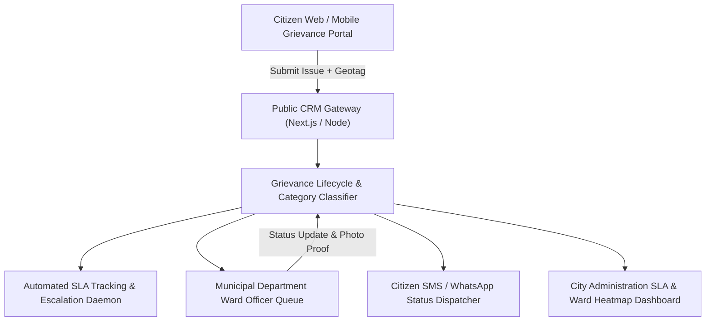

# 🏛️ Public CRM — Citizen Relationship Management & Public Grievance Redressal Portal
### *Transparent Civic Governance Platform: Municipal Issue Ticketing, Department SLA Tracking & Citizen Status Transparency*

  

  <a href="https://github.com/Tharun4743/Public-CRM">📦 <b>Official GitHub Repository</b></a>
  

---

## 1. 📌 Problem Statement & Context
Citizens facing civic infrastructure failures (potholes, water supply contamination, broken streetlights, waste accumulation) struggle with opaque government administrative offices. Grievances submitted via paper petitions or outdated portals disappear into bureaucratic black holes without accountability.

---

## 2. 🔍 Existing Solutions & Critical Gaps
Existing municipal portals lack transparent SLA timers, provide no photo proof verification, do not offer citizen notification updates, and lack automated escalation to senior ward engineers when local officers neglect issues.

---

## 3. 💡 Proposed Solution & Architectural Innovation
Public CRM is a modern citizen relationship management platform. Citizens easily report civic grievances with geo-tagging and photo uploads, while municipal department officers manage tickets through clear SLA resolution lifecycles with automated escalation rules and public accountability dashboards.

---

## 4. ⚙️ Technical Approach & System Architecture

### 📐 High-Level Architectural Flowchart:

| Governance Stage | Technology | System Mechanism |
| :--- | :--- | :--- |
| **Grievance Filing** | React 19, Leaflet Map GIS | Citizen geo-pins location, uploads photographic proof of infrastructure breakdown |
| **Department Routing**| Express.js, TypeScript | Auto-assigns issue to Road, Electrical, or Sanitation Ward Engineers |
| **SLA Escalation** | Automated Cron Timer Engine | Automatically escalates ticket to Municipal Commissioner if unresolved in 72h |

---

## 5. 📈 Quantifiable Impact & Measurable Benefits
* 🔍 **Radical Civic Transparency:** Citizens track their reported issues from submission to photographic resolution proof.
* ⏱️ **Accountability Enforcement:** Automated SLA timers penalize departmental negligence and accelerate civic repairs.
* 📊 **Empowered Municipal Administration:** Provides mayors and commissioners with heatmaps of recurring infrastructure failures across city wards.

---

## 6. 🚀 Feasibility, Operational Viability & Scalability
* 🔬 **Technical Feasibility:** Highly responsive web architecture accessible on mobile devices across diverse citizen demographics.
* 🏛️ **Civic Viability:** Ready for deployment across smart city initiatives, municipal corporations, and rural district administrations.

---

## 7. 👨‍💻 Author & Intellectual Property License

## 👨‍💻 Engineering Author

<table border="0">
  <tr>
    <td width="120" align="center" valign="top">
      
    </td>
    <td>
      <h3>Tharunkumar K</h3>
      

        <b>Full Stack Developer & AI Systems Engineer</b> 
        🎓 B.Tech in Information Technology — <a href="https://vsbec.com"><b>V.S.B. Engineering College, Karur</b></a> (Batch 2024–2028) 
        🌟 Recognized for holding the <b>Best GitHub Profile & Top Student Developer</b> at V.S.B. Engineering College (VSBEC) 
        🥇 <b>Winner — Code Thugs 2K26</b> • 🚀 <b>Smart India Hackathon (SIH)</b> Top 50 National Finalist
      

      

        <a href="https://tharunkumark4743.netlify.app/">🌐 Portfolio</a> •
        <a href="https://github.com/Tharun4743">🐙 GitHub (@Tharun4743)</a> •
        <a href="https://www.linkedin.com/in/tharunkumark4743">💼 LinkedIn</a> •
        <a href="https://leetcode.com/u/Tharunkumar__K/">🧩 LeetCode</a> •
        <a href="mailto:tharunkumark42007@gmail.com">📧 Email</a>
      

    </td>
  </tr>
</table>

### 🔒 Proprietary License Notice (All Rights Reserved)
> [!CAUTION]
> **PROPRIETARY & CONFIDENTIAL INTELLECTUAL PROPERTY**
> 
> All rights reserved. This repository, its architecture, source code, workflows, firmware, and associated documentation are the exclusive intellectual property of **Tharunkumar K**.
> 
> **No entity, organization, or individual is permitted to copy, modify, distribute, publish, commercially exploit, reverse engineer, or deploy any portion of this project without express, prior written permission from the author.**
> 
> **Copyright © 2026 Tharunkumar K. All Rights Reserved.**

<!-- =========================================================================
   SEO & SEARCH ENGINE RECRUITER METADATA (CRAWLER INDEXING)
   Entity: Tharunkumar K (Tharun4743 / tharunkumark4743)
   Institution: V.S.B. Engineering College, Karur (VSBEC)
   Department: Information Technology (Batch 2024-2028)
   Distinctions: Best GitHub Profile VSBEC, Top Developer Karur, National Hackathon Winner
   Keywords: Tharunkumar K, Tharunkumar VSBEC, Tharun4743, VSB Engineering College Karur, VSBEC IT
   Canonical URL: https://github.com/Tharun4743/Public-CRM
========================================================================= -->