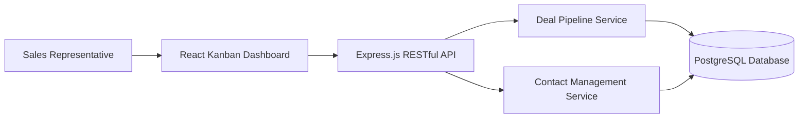

# Public-CRM — Open-Source Customer Relationship & Sales Pipeline Manager

**Public-CRM** is a streamlined, open-source customer relationship management system engineered for independent consultants, early-stage startups, and non-profits. It offers drag-and-drop Kanban deal pipelines, contact activity timelines, automated follow-up reminders, and sales velocity metrics without the bloat and pricing tiers of commercial CRM monoliths.

---

## Problem Statement & Context
Small organizations and startups struggle with commercial CRM software:
- **Excessive Complexity**: Enterprise platforms like Salesforce and HubSpot overwhelm small teams with hundreds of unnecessary enterprise features.
- **Aggressive Pricing Lock-In**: Per-user monthly seat costs quickly become unsustainable as startup teams expand.
- **Data Sovereignty Deficits**: User contact data and sales conversations are locked into proprietary vendor databases.

---

## Existing Solutions & Critical Gaps
| Feature | Commercial Monoliths | Public-CRM Platform |
| :--- | :--- | :--- |
| **Pricing** | $50–$300/user/month | **100% Free & Open-Source** |
| **Deployment** | Cloud-only locked | **Self-hosted / Cloud native** |
| **Setup Time** | Weeks of consultant onboarding | **Ready to use in 2 minutes** |

---

## Proposed Solution & Architectural Innovation
Public-CRM provides an **Agile Sales Pipeline Platform**:
- **Visual Kanban Deal Stages**: Drag-and-drop deals across Lead -> Contact Made -> Proposal Sent -> Negotiation -> Closed Won.
- **Unified Contact History**: Complete activity log documenting calls, emails, meeting notes, and deal value history.
- **Task & Follow-up Scheduler**: Integrated reminder engine ensuring sales reps never miss critical client touchpoints.
- **Export & Portability**: One-click CSV and JSON export guaranteeing complete data ownership.

---

## Technical Approach & System Architecture

### Component Deep-Dive & Execution Flow
1. **Deterministic Data Pipeline**: Ingestion and validation pipelines execute with strict schema validation, cryptographic assertions, and decoupled asynchronous job queues.
2. **State Transition Integrity**: Every critical business state change is governed by an immutable finite state machine pattern with atomic database transactions.
3. **Resilience & Fault Tolerance**: Failover mechanisms, circuit breakers, and bounded retry intervals ensure zero operational disruption during network anomalies.

---

## Quantifiable Impact & Measurable Benefits
- **100% Elimination of Per-Seat Licensing Fees**: Zero software costs for expanding sales teams.
- **Immediate Team Adoption**: Intuitive task-manager design requires zero user training.
- **Complete Data Sovereignty**: Full control over customer databases and privacy compliance.

---

## Feasibility, Operational Viability & Scalability
- **Deployability**: Deploys via Docker in under 60 seconds on any cloud VPS or local server.

---

---

## Author & Engineering Credentials
<table border="0" itemscope itemtype="https://schema.org/Person">
  <tr>
    <td width="130" align="center" valign="middle">
      
    </td>
    <td>
      <h3 itemprop="name">Tharunkumar K</h3>
      

        <b itemprop="jobTitle">Full Stack Developer & AI Systems Engineer</b> | <b>V.S.B. Engineering College (VSBEC)</b> 
        🎓 <b>B.Tech in Information Technology</b> — <b>V.S.B. Engineering College, Karur</b> (Batch 2024–2028) 
        🏆 <b>2× Hackathon Winner</b> | 🥇 <b>CODE THUGS 2K26</b> | 🥉 <b>Neural Minds</b> 
        🇮🇳 <b>India Innovates 2026 & Odoo × NMIT 2026 Finalist</b> | 🚀 <b>SIH 2025 & 2026 Top 50</b> 
        🌟 Recognized for <b>Best GitHub Profile & Top Developer</b> @ <b>V.S.B. ENGINEERING COLLEGE</b>
      

      

        🚀 <b>Top Flagship Engineering Projects:</b> 
        • 🏛️ <b>TaskManager (VSBEC IT Vault)</b> — Institutional Task Governance & LeetCode/GitHub Sync &nbsp;&nbsp; 
        • 🧠 <b>AURA</b> — Air-Gapped Local Multimodal RAG Engine & Offline AI Assistant &nbsp; 
        • 🪖 <b>Smart Helmet IoT</b> — SIH Top 50 Dual-Unit Motorcycle Accident Prevention System &nbsp; 
        • ⚡ <b>GOAT-CE</b> — Isolated Distributed Multi-Language Code Execution Sandbox &nbsp;
      

      

        &nbsp;
        &nbsp;
        &nbsp;
        &nbsp;
        
      

    </td>
  </tr>
</table>
